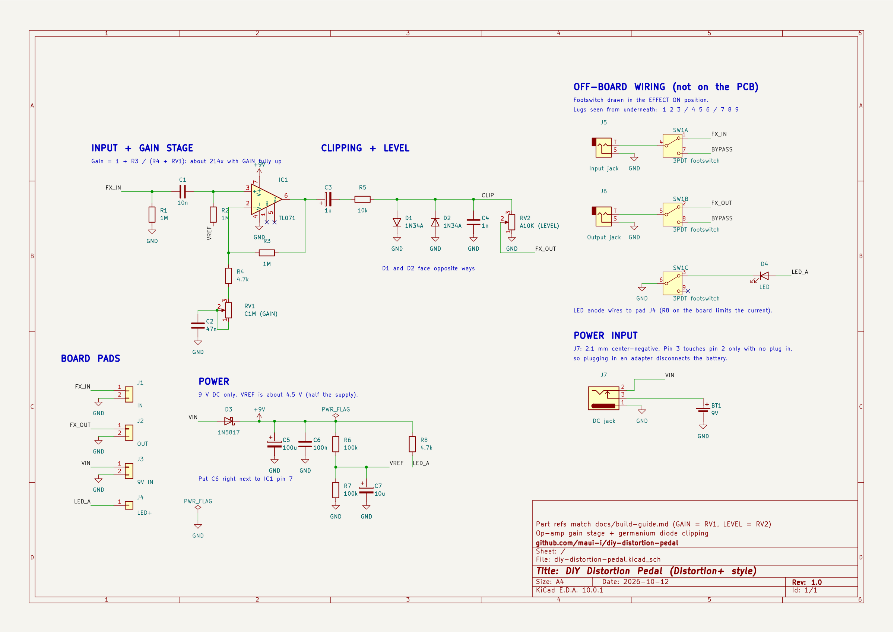

# How It Works

The pedal does three things to your guitar signal: it **amplifies** it far more than the circuit can pass cleanly, **clips** the result with two diodes, and **sets the volume** back to something usable. Everything else is support: power, biasing and filtering. Part references match the [schematic](../hardware/schematic.pdf) and the [build guide](build-guide.md).

## Power section

| Part | Job | Numbers |
| --- | --- | --- |
| D3 (1N5817) | Reverse-polarity protection: if the battery or adapter is connected backwards, the diode blocks it instead of the chip taking the hit. | A Schottky drops only about 0.2–0.4 V, so the circuit still gets about 8.6–8.8 V. |
| C5 (100 µF) | Smooths the supply and absorbs ripple from cheap adapters. | |
| C6 (100 nF) | Local decoupling at the chip's power pin. Stops the high-gain stage from oscillating (squealing). | Close to IC1 pin 7 on the PCB. |
| R6, R7 (100k each) | A voltage divider that makes **VREF**, half the supply. | 9 V × 100k / (100k + 100k) ≈ 4.5 V |
| C7 (10 µF) | Keeps VREF quiet. | R6 ∥ R7 = 50k with 10 µF: corner ≈ 0.3 Hz, so hum and hiss on the supply barely reach VREF. |

**Why VREF?** The op-amp runs from a single 9 V supply, so it can only output between 0 V and 9 V. A guitar signal swings above and below zero. Biasing the op-amp's input at 4.5 V lets the signal swing both ways around the middle of the supply.

## Gain stage

IC1 is a non-inverting amplifier. Its gain is set by the feedback resistor R3 and the resistance from the inverting input to ground, which is R4 plus the GAIN pot (RV1) in series with C2:

**Gain = 1 + R3 / (R4 + RV1)**

| GAIN knob | R4 + RV1 | Gain |
| --- | --- | --- |
| Fully clockwise | 4.7 kΩ | 1 + 1 MΩ / 4.7 kΩ ≈ **214×** (about 47 dB) |
| Middle (C-taper pot, roughly) | ~100 kΩ | ≈ 11× |
| Fully counter-clockwise | ~1 MΩ | ≈ **2×** |

A typical guitar puts out a few hundred millivolts peak. At 214× that would be tens of volts, far beyond the 9 V supply, so the signal is driven hard into clipping. That's the point.

The **C-taper (reverse-log)** GAIN pot spreads the useful range across the rotation: with a linear pot, most of the change would bunch up at the very end of the turn.

**Input parts:**

- **C1 (10 nF)** passes the guitar signal and blocks DC. With R2 (1 MΩ) to VREF it forms a high-pass filter at 1 / (2π × 1 MΩ × 10 nF) ≈ **16 Hz**: below the lowest guitar note (about 82 Hz), so nothing audible is lost.
- **R2 (1 MΩ)** biases the op-amp input at VREF, and its high value keeps the pedal's input impedance high so it doesn't load your pickups.
- **R1 (1 MΩ)** pulls the input to ground. Without it, C1 could charge up while the pedal is bypassed and make a loud pop when you switch it on.

**C2 (47 nF)** blocks DC in the gain leg, so the op-amp has a gain of exactly 1 for DC: VREF sets the output at 4.5 V with no drift. It also shapes the tone. It only lets the full gain happen above a corner frequency:

- At full gain: 1 / (2π × 4.7 kΩ × 47 nF) ≈ **720 Hz**. Bass below this is boosted less, which keeps the distortion tight instead of muddy. This is why the Distortion+ sounds mid-focused.
- At low gain the corner drops to a few hertz, so the whole range gets the (small) boost.

Making C2 bigger lowers the corner (more bass in the distortion); see [Mods](build-guide.md#mods-and-next-steps).

## Clipping and output

**C3 (1 µF)** removes the 4.5 V DC from the op-amp's output, so only the audio goes on. Its + leg faces the op-amp because that side sits at 4.5 V and the other side at 0 V.

**R5 (10 kΩ)** limits the current into the diodes.

**D1 and D2 (1N34A germanium)** are connected in opposite directions from the CLIP point to ground. Each starts to conduct once the voltage across it reaches its forward voltage, so they flatten the top (D1) and bottom (D2) of the wave. Germanium diodes conduct at only about **0.2–0.3 V**, and they start to conduct gradually rather than all at once, which gives a softer, smoother clip than silicon diodes (about 0.6–0.7 V and sharper). Because the clipping happens after the gain stage, the output is a squared-off wave of roughly ±0.3 V, whatever the gain.

**C4 (1 nF)** with R5 forms a low-pass filter at 1 / (2π × 10 kΩ × 1 nF) ≈ **16 kHz**. Clipping creates lots of high harmonics; this rolls off the harshest fizz.

**LEVEL (RV2, 10 kΩ audio taper)** is a simple volume control: a voltage divider from the CLIP point to ground. The audio taper makes the volume change evenly as you turn it.

## Bypass and LED

The 3PDT footswitch switches three things at once:

- **Effect on:** input jack → board IN, board OUT → output jack, and the LED's cathode to ground so it lights.
- **Bypass:** input jack → lug 7 → jumper → lug 8 → output jack. The circuit is completely out of the signal path ("true bypass"), and the LED goes dark.

**R8 (4.7 kΩ)** limits the LED current to about (9 V − 2 V) / 4.7 kΩ ≈ 1.5 mA: plenty for a modern LED, and gentle on the battery.

## Battery life

The TL071 draws about 1.4 mA, the VREF divider about 0.05 mA and the LED about 1.5 mA while the effect is on. That's roughly 3 mA in total. A typical 9 V alkaline battery (about 500 mAh) lasts on the order of 150 hours of playing. These are rough figures; batteries vary.

A plugged-in input jack doesn't switch the battery off on this design. Unplug the battery or use the DC jack when storing the pedal.

## Why the TL071 instead of the original 741?

Both work with exactly the same wiring. The TL071 has JFET inputs, so it's quieter with high-value resistors like R2, and it handles the high gain with more bandwidth: its 3 MHz gain-bandwidth gives about 3 MHz / 214 ≈ 14 kHz at full gain, versus about 5 kHz for a 741. The 741's earlier treble roll-off is part of the vintage sound, which is why it's listed as a mod.
