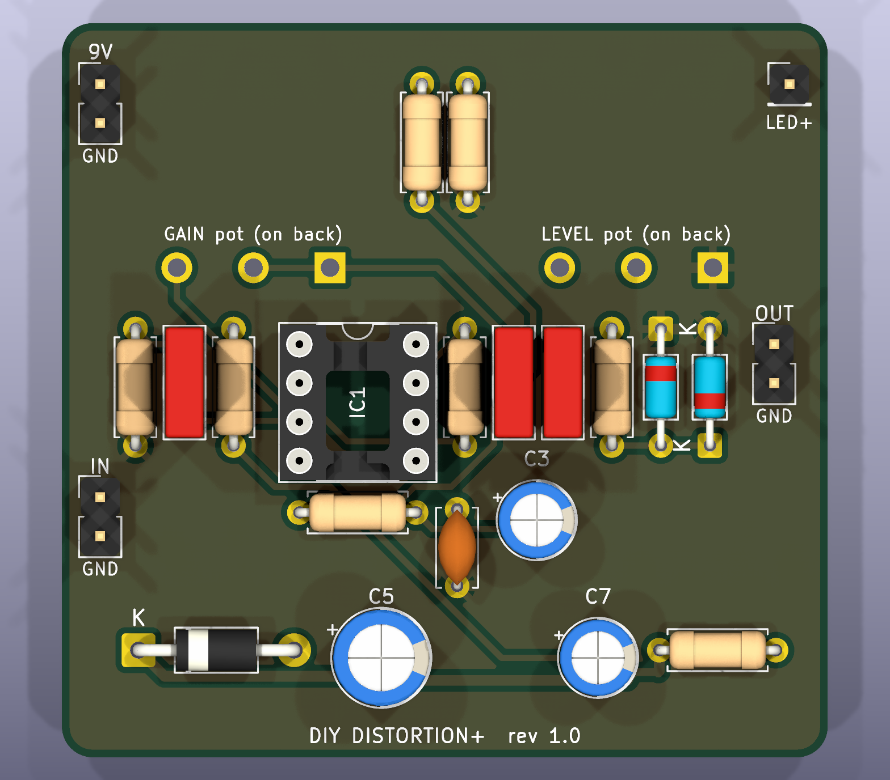
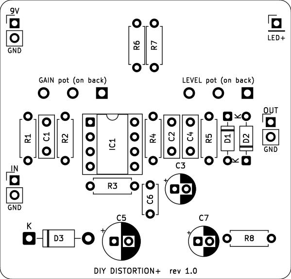
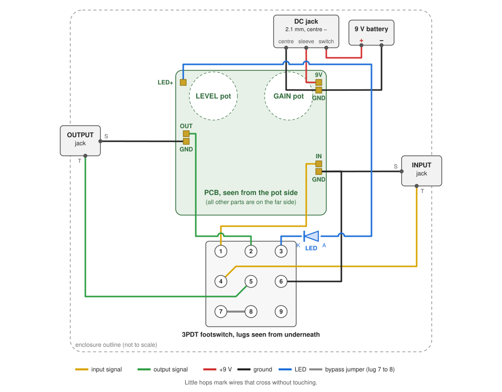

# PCB Build Guide

This is path 3: the same circuit as the [build guide](build-guide.md), on a printed circuit board you order online. Every part has its own labelled holes, so it's the easiest way to a permanent pedal. Read the [build guide](build-guide.md) first for the parts list, tools, soldering basics and troubleshooting; this page covers only what's different about the PCB.

## 1. Order the boards

1. Download [`hardware/fabrication/diy-distortion-pedal-gerbers.zip`](../hardware/fabrication/diy-distortion-pedal-gerbers.zip). Don't unzip it.
2. Upload it to any hobby PCB maker (JLCPCB, PCBWay, OSH Park, Aisler and others). Most show a preview: check it looks like the picture above.
3. Use the default settings. If asked:

| Setting | Value |
| --- | --- |
| Layers | 2 |
| Size | 50 × 48 mm (detected from the file) |
| Thickness | 1.6 mm |
| Min. track / spacing | 0.4 mm / 0.25 mm (any maker handles this) |
| Smallest hole | 0.8 mm |
| Surface finish | HASL (with or without lead) is fine |
| Colour | Your choice |

Boards usually come in a minimum batch of 5 and cost a few dollars plus shipping (approximate; prices vary). Spares are handy for a second pedal or for experimenting.

## 2. Extra parts for the PCB version

Everything in the [build guide's parts list](build-guide.md#materials) still applies, including the IC socket, footswitch and jacks. You do **not** need the breadboard or perfboard. Also check:

| Part | Notes |
| --- | --- |
| GAIN and LEVEL pots | **16 mm, PCB-mount, straight legs, 5 mm leg spacing** (e.g. Alpha RV16 series). These solder straight into the board. |
| Pin headers (optional) | 2.54 mm, for the J1–J4 pads if you'd rather plug wires in than solder them. |
| Hookup wire | About 1 m total for the off-board wiring. |

The resistors use 7.62 mm (0.3") hole spacing: standard 1/4 W resistors fit lying flat. The film capacitors use 5 mm spacing; the electrolytics use 2 mm (1 µF, 10 µF) and 2.5 mm (100 µF).

## 3. Solder the board

Work on the side with the white part outlines (the **component side**). Solder from the lowest parts to the tallest, so the board sits flat on the bench as you go. Check every part against the outline and the value table before soldering it.

| Order | Parts | Watch out for |
| --- | --- | --- |
| 1 | R1–R8 | No direction. 1M = R1, R2, R3; 4.7k = R4, R8; 10k = R5; 100k = R6, R7. |
| 2 | D1, D2 (1N34A) | The band goes to the end of the outline with the band printed on it (marked **K**). Glass breaks easily and gets hurt by heat: be quick, or hold the leg with pliers while soldering. |
| 3 | D3 (1N5817) | Band to the **K** (square pad) end. |
| 4 | IC socket | Notch matches the notch in the outline. **No chip yet.** |
| 5 | C1, C2, C4 (film), C6 (ceramic) | No direction. 10n (103) = C1, 47n (473) = C2, 1n (102) = C4, 100n (104) = C6. |
| 6 | C3, C5, C7 (electrolytic) | The **+** leg (longer leg, opposite the stripe) goes in the hole marked **+**, which is also the square pad. 1 µF = C3, 100 µF = C5, 10 µF = C7. |
| 7 | Headers or wires for J1–J4 | Optional headers now; otherwise solder wires in step 4. |
| 8 | GAIN and LEVEL pots | **On the back of the board.** See below. |

### The pots go on the back

The pots sit on the opposite side from everything else, so that when the board hangs from the enclosure lid the shafts poke through the lid and the other parts face into the box.

1. Turn the board over. The back has **GAIN** and **LEVEL** printed where each pot goes.
2. Push the pot's three legs through from the back, with the pot body against the board, and solder them on the component side.
3. Nothing else has its solder joints under the pots: that's deliberate, so the metal pot cases can't short anything. Still, put a small piece of electrical tape on the back of each pot case if it touches any bare copper.

Check the leg order: seen from the shaft end with the legs pointing down, legs are 1, 2, 3 from left to right (the same as in the build guide). The square pad is leg 1. Turning a knob clockwise then raises the gain or level.

## 4. Wire the jacks, footswitch, power and LED

These parts aren't on the board; they connect to the labelled pads with wires. The diagram shows the board as it sits in the box, seen from the pot side:

| From | To | Wire colour (suggested) |
| --- | --- | --- |
| Input jack tip | Footswitch lug 4 | Yellow |
| Footswitch lug 1 | Board **IN** | Yellow |
| Input jack sleeve | Board **GND** (next to IN) | Black |
| Footswitch lug 2 | Board **OUT** | Green |
| Footswitch lug 5 | Output jack tip | Green |
| Output jack sleeve | Board **GND** (next to OUT) | Black |
| Footswitch lug 7 | Footswitch lug 8 (short jumper) | Bare wire |
| Footswitch lug 6 | Board **GND** (any) | Black |
| Footswitch lug 3 | LED cathode (short leg) | Blue |
| LED anode (long leg) | Board **LED+** | Blue |
| DC jack sleeve lug | Board **9V** | Red |
| DC jack center-pin lug | Board **GND** (next to 9V) | Black |
| DC jack switch lug | Battery snap red | Red |
| Battery snap black | Board **GND** (next to 9V) | Black |

Footswitch lugs are numbered as seen from underneath (the solder-lug side), exactly as in the [build guide's footswitch section](build-guide.md#wiring-the-3pdt-footswitch-true-bypass-with-led): `1 2 3 / 4 5 6 / 7 8 9`. Check the orientation with your meter before soldering: lug 5 must beep with lug 2 in one position and with lug 8 after a click.

No battery? Skip the battery snap and the switch lug. No DC jack? Wire the battery snap's red lead straight to **9V** and black to **GND**. The board's R8 already limits the LED current, so the LED needs no resistor of its own.

The [schematic](../hardware/schematic.pdf) shows the same wiring in its **OFF-BOARD WIRING** box.

## 5. Power up and test

1. Before inserting the chip, connect power and measure with the meter's black probe on any GND pad. Socket pin 1 is the square pad next to the notch; pins 1–4 run down that side and 5–8 come back up the other.
   - 9V pad: 9 V. Socket pin 7: about 8.6–9.3 V. Socket pins 2 and 3: about 4.5 V.
2. Disconnect power, insert the TL071 with its notch matching the socket, and reconnect.
3. Socket pin 6 should now also read about 4.5 V.
4. Play-test exactly as in [part 2 of the build guide](build-guide.md#step-by-step-part-2-plug-in-your-guitar-and-test). Each click of the footswitch should switch between distortion (LED on) and your clean signal (LED off).

Something wrong? The [troubleshooting table](build-guide.md#troubleshooting) applies to the PCB too.

## 6. Box it up

The board is sized for a **Hammond 1590B** (or 125B for more room). The two pot shafts are 25 mm apart, centred on the board's width, 8.5 mm below its top edge. Mark the lid holes from your actual pots and board rather than from these numbers, since pot sizes vary slightly. See [when you're ready for an enclosure](build-guide.md#when-youre-ready-for-an-enclosure) for drill sizes and layout.
